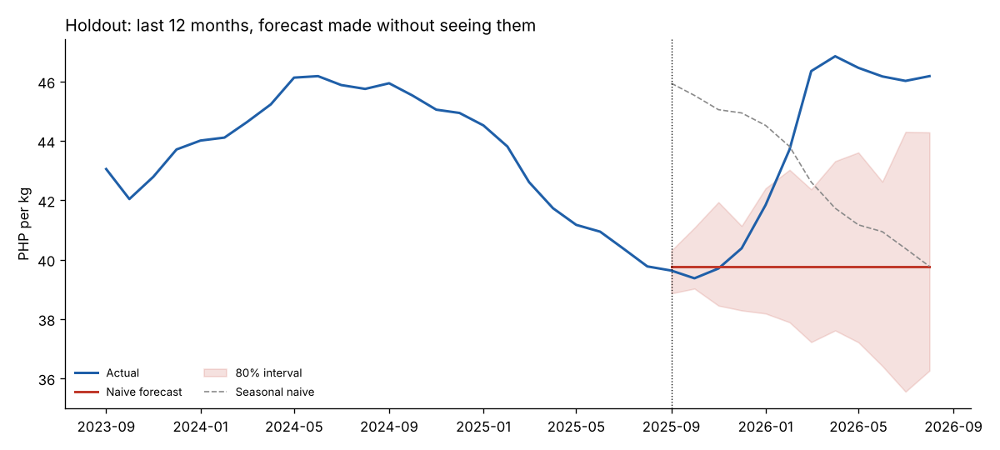

# Forecasting Philippine Rice Prices

Can machine learning beat a "no change" forecast for the retail price of rice in Metro Manila?
This project tests that on 26 years of real market data, with validation designed so the answer can be trusted.

**Short answer:** not with price history alone. A naive forecast beat every model in cross-validation,
and the last 12 months contained an 18% price jump that no history-based model could anticipate.
The write-up below shows the evidence and where the limits are.

## Data

[WFP Philippines Food Prices](https://data.humdata.org/dataset/wfp-food-prices-for-philippines) on the
Humanitarian Data Exchange (CC BY-IGO). Monthly market prices compiled from the Bureau of Agricultural
Statistics and the Philippine Statistics Authority.

- Series modeled: **Rice (regular, milled), retail price, Metro Manila**, PHP per kg, January 2000 to August 2026 (320 months).
- Why this series: it is the only rice series with a long, near-complete history. Other markets have about 6 reporting
  markets before 2020 and about 82 after, so a national average would jump in 2020 only because the market mix changed.
- 7 missing months (2015-11, 2015-12, 2016-05, 2016-06, 2019-06, 2020-03, 2020-04) were filled by linear interpolation.
- **Data quality note:** 75 of 313 reported months sit in long runs of an identical price, including 51 straight months at
  exactly PHP 30.00 from April 2009 and 24 months at PHP 18.00 from January 2000. This looks like carried-forward or
  administered reporting. I did not verify the cause. Those stretches are flat by construction, not by market behavior.

Download `wfp_food_prices_phl.csv` from the link above into `data/` (it is not committed because of its size).

## Method

| Step | What was done |
|---|---|
| Models | Naive, Seasonal naive, Holt-Winters (damped trend, additive seasonality, fitted on log price), Gradient boosting (one direct model for horizons 1 to 12 on lag, momentum and seasonality features), Equal-weight ensemble of Holt-Winters and gradient boosting |
| Validation | Rolling-origin (expanding window) cross-validation: 43 forecast origins from 2014-01 to 2024-07, every forecast 12 months ahead |
| Selection | By cross-validated MAE only |
| Holdout | The last 12 months (2025-09 to 2026-08) were set aside and scored once, after selection |
| Intervals | 80% prediction intervals from cross-validated log errors per horizon, checked for coverage on the holdout |

## Results

Cross-validation, 12-month-ahead forecasts averaged over all horizons and origins:

| Model | MAE (PHP/kg) | MAPE | MAE vs seasonal naive |
|---|---|---|---|
| Naive | 1.53 | 3.9% | -38% |
| Holt-Winters (damped) | 1.60 | 4.1% | -36% |
| Ensemble (HW + GB) | 1.67 | 4.2% | -33% |
| Gradient boosting | 1.91 | 4.8% | -23% |
| Seasonal naive | 2.48 | 6.3% | baseline |

Holdout, last 12 months (scored once):

| Model | MAE (PHP/kg) | MAPE |
|---|---|---|
| Naive | 3.89 | 8.5% |
| Holt-Winters (damped) | 4.35 | 9.5% |
| Seasonal naive | 4.72 | 10.9% |
| Ensemble (HW + GB) | 5.20 | 11.5% |
| Gradient boosting | 6.04 | 13.4% |



## What I learned

1. **Rice prices here behave like a persistent, slow-moving series with occasional shocks.** Forecasts that assume
   "next month looks like this month" are hard to beat, and the error of every model grows steadily with horizon
   (about PHP 0.5 at 1 month to about PHP 2.4 at 12 months).
2. **Seasonality is weak.** The seasonal naive forecast was the worst model in cross-validation, about 60% worse than naive.
3. **Gradient boosting did not help** with price history alone. With about 300 monthly points there is little for it to learn,
   and it was the worst non-seasonal model.
4. **The holdout was dominated by a shock.** Prices drifted down to PHP 39.4 by October 2025, then rose about 18% to
   PHP 46.4 by March 2026. No model based on past prices could see that coming.
   I have not verified what caused it.
5. **The intervals were too narrow.** The 80% intervals covered only 42% of holdout months, because they were calibrated
   on cross-validation periods that were calmer than the holdout.

## Limitations

- The final 12-month forecast (`outputs/forecast_next_12_months.csv`) is a flat PHP 46.18 with an 80% interval of about
  PHP 42 to 51 by August 2027. Treat it as a "no-change" benchmark, not a prediction of a calm year.
- One market and one commodity. Results may differ for other series.
- SARIMA was not run because statsmodels was not available in the environment used to build this. That is a natural
  addition.

## Next steps

- Add outside drivers (import and policy changes, typhoon and rainfall data, fuel prices, CPI) and test whether any of them
  improves on the naive benchmark.
- Build a panel model across the roughly 82 markets reporting since 2020, where there is far more data per model.
- Calibrate intervals with a method that adapts to recent volatility (for example, conformal prediction over a recent window).

## Run it

```
pip install -r requirements.txt
python src/forecast_rice.py
```

Outputs are written to `outputs/` (tables, figures, and `run_log.txt` from the run described above).
